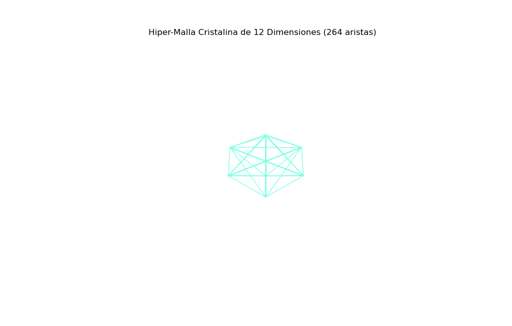

# Motor de Geometría Hiperdimensional 12D

**Resumen del Sistema:** Este software genera un politopo cruzado (*Cross-Polytope*) en un espacio de 12 dimensiones, aplica rotaciones entrelazadas simultáneas a través de múltiples hiperplanos, colapsa la estructura mediante una proyección en cascada con perspectiva espacial hasta 3D y ejecuta el renderizado continuo utilizando **NumPy** y **Matplotlib** sobre el sistema operativo **Linux Mint**.

---

## Demostración Visual

### Imagen de Rendimiento


### Video de Animación en Tiempo Real
<video src="2026-10-30 20-17-31.mp4" controls width="100%"></video>

---

## 1. Entorno de Ejecución: Linux Mint + Python

La combinación del entorno Linux Mint y el intérprete Python permite un procesamiento eficiente con un consumo reducido de recursos del sistema:

* **NumPy:** Gestiona la vectorización matemática masiva y las transformaciones matriciales requeridas para operar en espacios de 12 dimensiones sin generar cuellos de botella en la memoria.
* **Matplotlib (`FuncAnimation`):** Administra el bucle de renderizado gráfico a 60 FPS, proyectando la malla 3D mediante la técnica de separación de aristas por valores `np.nan`.

---

## 2. Arquitectura Matemática y Modular

### A. Creación del Hiper-Politopo (12D)
```python
DIMENSIONES = 12
```
* **Vértices (24 Puntos):** En un *Cross-Polytope* de 12D existen 12 ejes ortogonales. Cada eje cuenta con un polo positivo ($+2.0$) y uno negativo ($-2.0$), generando exactamente $12 \times 2 = 24$ vértices ortogonales.
* **Aristas Hiper-Cristalinas:** Se interconectan todos los vértices entre sí, a excepción de los polos opuestos directos (`-vertices[j]`), estructurando una red hiperdimensional completa.

### B. Rotación Entrelazada en Hiperplanos
La función `rotacion_hiperdimensional` realiza la transformación angular:
* Recorre los pares de dimensiones consecutivas (`range(0, DIMENSIONES - 1, 2)`).
* Asigna a cada hiperplano un factor de velocidad incremental (`1.0 + (d * 0.15)`), produciendo una rotación asíncrona continua a través de múltiples planos espaciales.

### C. Proyección en Cascada (12D a 3D)
El algoritmo implementa una reducción dimensional progresiva:
* Mediante un ciclo descendente (`for d in range(DIMENSIONES - 1, 2, -1)`), colapsa secuencialmente cada dimensión desde 12D hasta 3D.
* Aplica un factor de perspectiva espacial (`distancia / (distancia - puntos_actuales[:, d] * 0.6)`), previniendo asíntotas y preservando la percepción de profundidad visual.

### D. Optimización del Renderizado
* **Vectorización:** Las coordenadas de los vértices y aristas se empaquetan en arreglos lineales (`xs`, `ys`, `zs`).
* **Delimitación por NaN:** Se intercalan valores `np.nan` para dibujar la totalidad de las aristas mediante una única llamada al método `ax.plot`, maximizando el rendimiento por fotograma.

---

## 3. Código Fuente Principal (`dodecaracto.py`)

```python
import numpy as np
import matplotlib.pyplot as plt
from matplotlib.animation import FuncAnimation

# Configuración dimensional
DIMENSIONES = 12  

print(f"Iniciando motor en {DIMENSIONES}D. Procesando geometría del hiperespacio.")

# 1. Generación del Cross-Polytope en 12D (24 vértices)
base_vertices = []
for i in range(DIMENSIONES):
    v1 = np.zeros(DIMENSIONES)
    v2 = np.zeros(DIMENSIONES)
    v1[i] = 2.0
    v2[i] = -2.0
    base_vertices.append(v1)
    base_vertices.append(v2)
vertices = np.array(base_vertices, dtype=float)

# 2. Definición de aristas (conexión entre ejes no opuestos)
edges = []
num_vertices = len(vertices)
for i in range(num_vertices):
    for j in range(i + 1, num_vertices):
        if not np.allclose(vertices[i], -vertices[j]):
            edges.append((i, j))

# 3. Transformación matricial de rotación multidimensional
def rotacion_hiperdimensional(points, angulo):
    R = np.copy(points)
    for d in range(0, DIMENSIONES - 1, 2):
        factor_velocidad = 1.0 + (d * 0.15)
        c = np.cos(angulo * factor_velocidad)
        s = np.sin(angulo * factor_velocidad)
        
        eje_x = R[:, d].copy()
        eje_y = R[:, d + 1].copy()
        
        R[:, d] = eje_x * c - eje_y * s
        R[:, d + 1] = eje_x * s + eje_y * c
    return R

# 4. Proyección en cascada progresiva (12D -> 3D)
def proyeccion_12d_a_3d(points, distancia=4.0):
    puntos_actuales = np.copy(points)
    for d in range(DIMENSIONES - 1, 2, -1):
        factor = distancia / (distancia - puntos_actuales[:, d] * 0.6)
        puntos_actuales = puntos_actuales[:, :d] * factor[:, None]
    return puntos_actuales

# 5. Inicialización del lienzo tridimensional
fig = plt.figure(figsize=(9, 9))
ax = fig.add_subplot(111, projection='3d')
plt.title(f"Hiper-Malla Cristalina de {DIMENSIONES} Dimensiones ({len(edges)} aristas)")

ax.set_xlim([-3, 3])
ax.set_ylim([-3, 3])
ax.set_zlim([-3, 3])
ax.axis('off')

line, = ax.plot([], [], [], color='#00ffcc', alpha=0.5, lw=1.0)

# 6. Actualización por fotograma
def update(frame):
    angulo = frame * 0.015
    
    rotated = rotacion_hiperdimensional(vertices, angulo)
    projected = proyeccion_12d_a_3d(rotated)
    
    xs, ys, zs = [], [], []
    for i, j in edges:
        xs.extend([projected[i, 0], projected[j, 0], np.nan])
        ys.extend([projected[i, 1], projected[j, 1], np.nan])
        zs.extend([projected[i, 2], projected[j, 2], np.nan])
        
    line.set_data(xs, ys)
    line.set_3d_properties(zs)
    
    ax.view_init(elev=20 + np.sin(frame * 0.03) * 5, azim=frame * 0.4)
    return line,

ani = FuncAnimation(fig, update, frames=360, interval=20, blit=True)
plt.show()
```

---

## 4. Instrucciones de Ejecución

1. Abrir la terminal de comandos:
   ```bash
   Ctrl + Alt + T
   ```

2. Instalar las librerías requeridas:
   ```bash
   pip install numpy matplotlib
   ```

3. Crear el archivo del programa:
   ```bash
   nano dodecaracto.py
   ```

4. Ejecutar el script:
   ```bash
   python3 dodecaracto.py
   ```